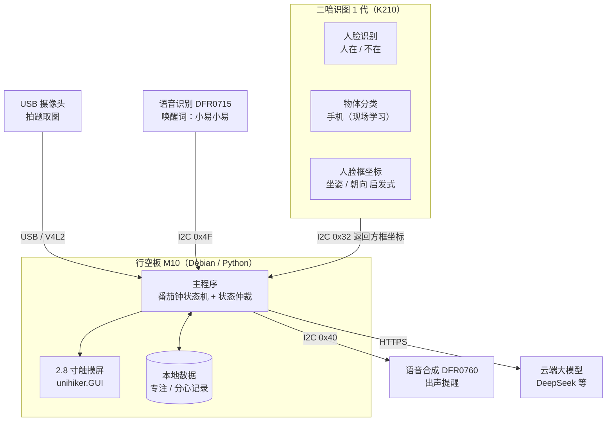

# 智能番茄时钟 Smart Tomato

> 一台会"盯着你学习"的番茄钟。基于 **行空板 M10 + 二哈识图 1 代**，用视觉传感器判断你在不在座位上、有没有在玩手机、坐姿是否端正、目光是否落在作业上，在你走神时出声提醒；想问题时喊一声"小易小易"，拍下题目交给大模型讲解。

[]()
[]()
[]()
[]()

---

## 目录

- [1. 项目简介](#1-项目简介)
- [2. 功能特性](#2-功能特性)
- [3. 硬件清单](#3-硬件清单)
- [4. 接线说明](#4-接线说明)
- [5. 系统架构](#5-系统架构)
- [6. 部署与运行](#6-部署与运行)
- [7. 配置说明](#7-配置说明)
- [8. 使用说明](#8-使用说明)
- [9. 常见问题](#9-常见问题)
- [10. 已知限制与路线图](#10-已知限制与路线图)
- [11. 问题反馈](#11-问题反馈)
- [12. 版权声明](#12-版权声明)
- [附录 A：二哈识图 1 代能力边界与四项需求的实现方式](#附录-a二哈识图-1-代能力边界与四项需求的实现方式)
- [附录 B：未来升级到二哈识图 2 代](#附录-b未来升级到二哈识图-2-代)

---

## 1. 项目简介

写作业时最大的敌人不是难题，而是走神。**智能番茄时钟**把"番茄工作法"和"学习状态监督"合二为一：

- 它**看得见你**——判断你是否还在座位上；
- 它**管得住你**——检测到玩手机、趴桌、目光偏离时主动出声提醒；
- 它**懂你的习惯**——记录专注与分心数据，由大模型给出个性化学习建议，并自动调整番茄钟节奏；
- 它**讲得清题**——语音唤醒后拍照，题目交给大模型逐步讲解。

与普通番茄钟 App 的区别：本设备是**独立硬件**，不依赖手机，也不会被手机上的其他通知打断。

### 核心选型：为什么是二哈识图 1 代

本项目当前使用 **二哈识图 1 代（HUSKYLENS，SEN0305）** 作为视觉模块。它内置 7 种算法，其中 **3 种**直接服务于本项目的状态监督需求，并且**推理全部在传感器内部完成**，主控不承担视觉计算：

| 项目需求 | 二哈 1 代对应能力 | 可靠性 |
|---|---|---|
| 人是否在座 | **人脸识别** | 高 |
| 是否在玩手机 | **物体分类**（现场学习"手机"类别） | 中 |
| 坐姿异常（低头、趴桌） | 人脸框几何特征**启发式推断** | 中低 |
| 朝向是否对着作业 | 人脸框几何特征**启发式推断** | 中低 |
| 拍照解题取图 | ❌ 不支持，需**外接 USB 摄像头** | — |

由此带来的直接收益：

1. **M10 不承担视觉推理**——M10 算力有限（四核 1.2GHz / 512MB 内存），推理放在二哈内部，M10 只负责逻辑、显示与联网；
2. **零训练成本**——"人在不在""玩手机"分别用内置的人脸识别与物体分类完成，无需自己训练模型；
3. **完全离线**——状态识别不依赖网络，隐私数据不出设备。

> ⚠️ 但二哈 1 代**不输出图像**、**没有姿态与朝向模型**。前者导致"拍题取图"必须另配 USB 摄像头，后者导致"坐姿"和"朝向"只能用启发式规则近似，**误报率偏高**。完整的边界分析与实现方式见[附录 A](#附录-a二哈识图-1-代能力边界与四项需求的实现方式)。
>
> 二哈识图 **2 代**可以一次性补齐这些短板（人体关键点、姿态识别、人脸朝向、注视方向、内置相机）。本项目已把它列为**未来升级路径**，见[附录 B](#附录-b未来升级到二哈识图-2-代)。

---

## 2. 功能特性

### 2.1 时间显示与番茄钟

- 2.8 寸屏横屏显示大号数字时钟 + 日期星期
- 标准番茄钟状态机：专注 → 短休息 → 专注 → …… → 长休息
- 专注时长、休息时长可配置；支持手动暂停与跳过

> 状态：**已实现**（`m10_step3_away_last.py`，当前上板程序）。历次版本归档在 `old/`。

### 2.2 学习状态监督

全部由二哈识图 1 代完成，**推理在传感器内部、完全离线**：

| 状态 | 二哈 1 代算法 | 判定方式 | 可靠性 |
|---|---|---|---|
| 人是否在座 | 人脸识别 | 连续 N 帧检测不到人脸框 → 判定离座 | 高 |
| 是否在玩手机 | 物体分类 | 现场学习"手机"类别后，检测到该 ID 即判定 | 中 |
| 坐姿异常 | 人脸识别（复用） | 人脸框中心 y 持续低于阈值 / 框高骤变 → 低头或趴桌 | 中低 |
| 朝向是否对着作业 | 人脸识别（复用） | 人脸框中心 x 偏移超阈值、或框宽明显变窄 → 头部转开 | 中低 |

判定为"开小差"后，通过语音合成模块出声提醒。提醒策略采用**渐进式**：首次轻声提示，持续分心则提高提醒强度，避免频繁打断心流。

> 说明：坐姿与朝向两项是**几何启发式**，不是真正的人体姿态/头部朝向识别，**正常低头写字也可能被误判**。建议在配置中把它们设为"仅记录、不提醒"，或按个人习惯校准阈值。详见[附录 A.4](#a4-坐姿与朝向为什么只能做启发式)。
>
> 状态：语音唤醒、语音播报与**离座监督已实现**（`m10_step3_away_last.py`，板上运行）；玩手机/坐姿/朝向判定规划中。

### 2.3 学习习惯学习

- **数据记录**：每次专注的起止时间、分心次数、分心发生的时段分布
- **LLM 分析**：把历史数据交给大模型，生成个性化的学习建议（如"你在 20:00 后专注度明显下降"）
- **自动调整**：根据历史规律自动调整番茄钟时长与提醒时机

> 状态：规划中。

### 2.4 语音唤醒拍照解题

1. 说出唤醒词"小易小易"，设备进入待命
2. 再说"开始识别"，由 **USB 摄像头**连拍多张
3. 设备自动**挑选最清晰的一张**（清晰度评分）
4. 上传至云端大模型，返回分步讲解并在屏幕上显示

> 注意：二哈 1 代无法提供图像（拍照只存它自己的 SD 卡），因此**本功能依赖外接 USB 摄像头**，使用的是 M10 空余的 USB Type-A 口。
>
> 状态：规划中。

---

## 3. 硬件清单

| 类别 | 型号 / 规格 | 数量 | 说明 |
|---|---|---|---|
| 主控 | **行空板 M10**（UNIHIKER，DFR0706） | 1 | RK3308 四核 1.2GHz / 512MB DDR3 / 16GB eMMC / Debian 10 |
| 视觉 | **二哈识图 1 代**（HUSKYLENS，SEN0305） | 1 | K210，内置 7 种算法，I2C 地址 `0x32` |
| 语音 · 输入 | **DFR0715**（Gravity I2C 离线语音识别，芯片 LD3320） | 1 | I2C 地址 `0x4F`，关键词在代码中用拼音定义 |
| 语音 · 输出 | **DFR0760**（Gravity 中英文语音合成，V2） | 1 | I2C 地址 `0x40`，用于出声提醒与语音反馈 |
| 拍照 | **USB 摄像头**（UVC 免驱） | 1 | 插 M10 的 USB Type-A 口，供"拍题解题"取图 |
| 显示 | 行空板板载 2.8 寸 240×320 触摸彩屏 | — | 无需外接 |
| 电源 | Type-C 5V / 2A 电源适配器 | 1 | 仅可从 Type-C 口供电 |

### 二哈识图 1 代规格

| 项目 | 参数 |
|---|---|
| 处理器 | Kendryte K210 |
| 图像传感器 | OV2640 或 GC0328 |
| 显示屏 | 2.0 寸 IPS，320 × 240 |
| 内置功能 | 人脸识别、物体追踪、物体识别、巡线追踪、颜色识别、标签识别、物体分类 |
| 处理帧率 | 物体追踪 / 人脸识别 / 物体识别：15 Hz；颜色识别 / 巡线 / 标签识别：30 Hz |
| 连线接口 | UART（9600 / 115200 / 1000000）或 I2C，默认自动识别 |
| 供电 / 电流 | 3.3–5.0V；320 mA @3.3V、230 mA @5.0V（人脸识别、80% 背光、补光灯关闭） |
| 尺寸 | 52 × 44.5 mm |
| 其他 | 功能按键 ×1、补光灯 ×2、TF 卡槽（存照片与模型） |

### 行空板 M10 板载资源（无需外接）

| 功能 | 说明 |
|---|---|
| CPU / 内存 / 存储 | RK3308 四核 1.2GHz（Arm 64 位）/ 512MB DDR3 / 16GB eMMC |
| 操作系统 | Debian 10，预装完整 Python 环境 |
| 屏幕 | 2.8 寸 240×320 可触控彩屏 |
| 麦克风 | 板载电容硅麦克风 |
| 蜂鸣器 | 板载无源蜂鸣器 |
| 传感器 | 光线传感器、六轴传感器（加速度 + 陀螺仪） |
| 按键 | Home 键、A 键、B 键 |
| 无线 | Wi-Fi 2.4G + 蓝牙 4.0 |

---

## 4. 接线说明

| 外设 | 外设接口 | 接入 M10 的端口 | I2C 地址 |
|---|---|---|---|
| 二哈识图 1 代 | 4Pin Gravity（UART/I2C） | **4Pin I2C 口**（任一路） | `0x32` |
| 语音识别 DFR0715 | 4Pin Gravity（I2C） | **4Pin I2C 口**（任一路） | `0x4F` |
| 语音合成 DFR0760 | 4Pin Gravity（I2C） | **4Pin I2C 口**（任一路） | `0x40` |
| USB 摄像头 | USB Type-A | **USB Type-A 口** | — |

> **M10 的两个 4Pin I2C 口是同一条 I2C1 总线的并联引出**（引脚 P19 = SCL、P20 = SDA），不是两路独立总线。因此**三个 I2C 模块可以任意分配到两个口上，也可以全部串在同一个口**——只要地址不冲突（0x32 / 0x40 / 0x4F 互不冲突）。代码里统一使用 `I2C(bus=0)`。

### 接线注意事项

1. **供电**：仅可从 Type-C 口供电，输入电压不得超过 5.5V，否则可能烧毁主板芯片。
2. **二哈 1 代功耗**：典型 320mA @3.3V，明显高于一般传感器。若同时接入语音模块后出现工作不稳定，请通过**二哈自己的 Type-C 口独立供电**，不要仅依赖 4Pin 口的供电能力。
3. **别插错口**：二哈与语音模块都要接 **4Pin I2C 口**。M10 另有 4 个 **3Pin I/O 口**（P21~P24），插到那里是**扫不到设备的**。
4. **二哈的通信模式**：二哈支持 UART 与 I2C，默认**自动识别**。若通信异常，可在其"常规设置"中确认协议设置。
5. **USB 摄像头**：必须是 **UVC 免驱**型号，Linux 下会枚举为 `/dev/video*`。

---

## 5. 系统架构



### 数据流说明

1. **状态监督回路**（本地、离线）：二哈 1 代内部完成人脸识别与物体分类，只把结构化结果（人脸框坐标、学习到的物体 ID）通过 I2C 回传给 M10；M10 据此判断是否在座、是否玩手机，并用框的几何特征推断坐姿与朝向。
2. **番茄钟回路**（本地、离线）：主程序维护计时状态，驱动屏幕刷新与语音提示。
3. **解题回路**（联网）：语音唤醒 → USB 摄像头连拍 → 择优 → HTTPS 上传大模型 → 结果回显。
4. **习惯学习回路**（联网）：本地数据 → 汇总上传 → 大模型分析 → 返回建议并调整番茄钟参数。

### 二哈 1 代内置能力清单

**7 种算法：** 人脸识别、物体追踪、物体识别、巡线追踪、颜色识别、标签识别、物体分类。

**辅助功能：** 自定义 ID 名称、拍照/截屏保存到 SD 卡、SD 卡保存/加载模型。

**物体识别的 20 个固定类别：** 飞机、自行车、鸟、船、瓶子、巴士、汽车、猫、椅子、牛、餐桌、狗、马、摩托车、**人**、盆栽、羊、沙发、火车、电视。

> 注意：20 类中**有"人"、没有"手机"**。因此"人是否在座"也可以退而用物体识别的"人"类；而"玩手机"必须走**物体分类**——现场学习"手机"这一类。

---

## 6. 部署与运行

### 6.1 开发环境

推荐使用 **Mind+ 的 Python 积木模式**（本机已验证可用）。

> 注意：Mind+ 的 **Python 代码模式在本版本不可用**（`canUse=false`），请使用积木模式。
> 工程目录：`%LOCALAPPDATA%\mind+\python-block\projects\<项目名>\`，运行入口为工程下的 `main.py`。

### 6.2 依赖

行空板 M10 的 Debian 环境预装了 Python 与常用库。本项目依赖：

```bash
pip install unihiker        # 屏幕与音频
pip install pillow          # 图像合成与旋转
pip install requests        # 云端大模型调用
pip install pinpong         # 驱动板载元件与扩展模块
```

**二哈识图 1 代无需额外安装库**——`pinpong` 已自带官方驱动：

```python
from pinpong.libs.dfrobot_huskylens import Huskylens, Parameter
```

> 板载路径：`pinpong/libs/dfrobot_huskylens.py`（本机实测已存在，无需 `pip install`）。
> 语音识别同样走 pinpong 自带库 `pinpong.libs.dfrobot_asr`；语音合成走 `pinpong.libs.dfrobot_speech_synthesis`。

在 Mind+ 中使用时，请在**用户库**中搜索「二哈识图」并加载对应库文件。

> **版本说明（实测）**：开发端 Mind+ 内置 **Python 3.11.9**；行空板 M10 板载 **Python 3.7.3 + Pillow 9.0.1**（Debian 10 出厂）。
> 本项目代码已对 **Pillow < 10** 做兼容（`make_font` 字体兜底走 `except TypeError`），在板载环境下可直接运行，**无需升级 Pillow**；若要在开发端锁定版本，推荐 `unihiker==0.0.27`、`pinpong==0.6.2`、`Pillow>=10`。

### 6.3 运行

**方式一：Mind+ 积木模式**

1. 打开 Mind+ → 选择「Python 积木模式」
2. 打开本仓库对应项目，确认 `main.py` 为最新代码
3. 连接行空板 M10（USB 或 Wi-Fi）
4. 点击运行

**方式二：SSH 直接运行**

```bash
# 出厂默认连接信息
ssh root@10.1.2.3          # 密码：dfrobot

# 上传并运行
scp main.py root@10.1.2.3:/root/smarttomato/
ssh root@10.1.2.3 "cd /root/smarttomato && python3 main.py"

# 后台常驻运行（脱离 SSH 会话，断开后仍继续）
ssh root@10.1.2.3 "cd /root/smarttomato && setsid nohup python3 -u main.py > voice_clock.log 2>&1 < /dev/null &"
```

> 屏幕类程序需要持续运行，请勿让主进程退出。用 `setsid nohup ... &` 启动后进程的 PPID 会变成 1，可脱离 SSH 会话独立存活。

### 6.4 二哈识图 1 代准备

1. **更新固件**：建议固件版本不低于 **V0.5.1a**（该版本起把包括"物体分类"在内的全部功能集成在一起）。固件可通过官方 HUSKYLENS 上传工具烧录。
2. **插好 SD 卡**：若要使用"拍照/截屏保存"或"模型存/取"功能，需插入 **FAT32** 格式的 SD 卡。
3. **选择算法**：在设备上拨动功能按键选择算法，或用代码 `command_request_algorthim(...)` 切换。
4. **学习"手机"类别**（关键步骤）：
   - 拨到 **物体分类** → 长按功能键 → 打开「学习多个」→ 保存并返回；
   - 把屏幕中央的橙黄色大框对准手机，**长按学习键**，从不同角度、不同距离各学一次；
   - 同一个物体学得越多，识别越准。松开学习键后按功能键结束。
   - 也可用代码触发：`command_request_learn_once(id)` / `command_request_forget()`。
5. **命名类别**（可选）：用 `command_request_customnames(id, "phone")` 给学到的 ID 起名，便于阅读。

> 切换算法后建议**延时约 5 秒**再进行读取操作，等摄像头画面稳定。

---

## 7. 配置说明

### 7.1 已实现参数（`m10_step3_away_last.py`，当前上板程序）

命令行参数：

| 参数 | 含义 | 默认值 |
|---|---|---|
| `--focus-min` | 专注时长（分钟） | 25 |
| `--away-sec` | 连续多久没人脸判离座并暂停番茄钟（秒） | 60 |
| `--l2-sec` | 中提醒阈值（秒） | 180 |
| `--l3-sec` | 强提醒阈值（秒） | 300 |
| `--no-voice` | 不初始化语音模块（纯屏幕） | — |
| `--no-tts` | 只关语音合成，保留语音识别 | — |
| `--no-husky` | 不用二哈，改由触发文件驱动离座 | — |
| `--husky-lib-read` | 二哈额外跑一遍库读法做对照（慢 15 倍，仅调试） | — |
| `--demo` | 启动 8 秒后自动触发一次番茄钟 | — |
| `--preview PNG` | 不连板子，把六态拼成一张图 | — |

语音命令（关键词为**空格分音节的拼音**，由固件解析）：

| 说 | 拼音 | 作用 |
|---|---|---|
| 开始学习 | `kai shi xue xi` | 开番茄钟 |
| 暂停学习 | `zan ting xue xi` | 手动暂停（回座不会自动解开） |
| 继续学习 | `ji xu xue xi` | 恢复倒计时 |
| 停止学习 | `ting zhi xue xi` | 结束本次专注，回待机 |

> 早期版本（`m10_voice_clock.py` 的 `ROTATE` / `REPLY_MODE` / `WAKE_WORDS` 等）
> 已归档到 `old/`，不再是当前配置入口。
| `VOICE_DEBUG` | 打印识别到的关键词 ID，便于调试 | True |

### 7.2 规划中参数

| 参数 | 含义 | 默认值 |
|---|---|---|
| `FOCUS_MINUTES` | 单次专注时长（分钟） | 25 |
| `SHORT_BREAK_MINUTES` | 短休息时长（分钟） | 5 |
| `LONG_BREAK_MINUTES` | 长休息时长（分钟） | 15 |
| `DISTRACTION_TIMEOUT` | 持续分心多久触发提醒（秒） | 30 |
| `REMIND_LEVEL_STEP` | 提醒强度递进步长（秒） | 30 |
| `ABSENT_TIMEOUT` | 连续无人多久判定为离座（秒） | 60 |
| `POSTURE_Y_THRESHOLD` | 坐姿启发式的人脸框 y 阈值 | 需现场校准 |
| `FACING_X_THRESHOLD` | 朝向启发式的人脸框 x 偏移阈值 | 需现场校准 |
| `SHOT_COUNT` | 拍题连拍张数 | 5 |
| `LLM_API_BASE` | 大模型接口地址 | `https://api.deepseek.com` |
| `LLM_API_KEY` | 大模型 API Key | 从环境变量读取 |

> 坐姿与朝向的两个阈值**必须在实际使用场景下现场校准**，否则误报会很多。

### 密钥安全

**请勿将 API Key 硬编码进源码并提交到仓库。** 推荐做法：

```bash
export LLM_API_KEY="sk-xxxxxxxx"
```

或在项目根目录创建 `.env`（已加入 `.gitignore`）。

---

## 8. 使用说明

### 语音指令

| 指令 | 作用 |
|---|---|
| 小易小易 / 老头子 | 唤醒词，进入待命状态 |
| 开始学习 | 启动一个番茄钟 |
| 暂停 | 暂停计时 |
| 继续 | 恢复计时 |
| 开始识别 | 拍照并提交解题 |
| 我休息一下 | 提前进入休息 |

> 语音识别模块 DFR0715 的关键词是**在代码里用拼音定义**的（`add_command("xiao yi xiao yi", 1)`），**不需要在模块上"学习"**。上表命令词可按需在 `WAKE_WORDS` 中增删。
> 使用要点：关键词建议 4~6 个音节；说话时**离麦克风 10cm 以上**，贴太近识别率会明显下降。

### 屏幕界面

- **待机**：横屏大号时钟 + 日期星期
- **专注中**：倒计时 + 剩余时间进度
- **提醒**：全屏提示 + 语音播报
- **解题**：题目原图 + 分步讲解

### 按键

| 按键 | 作用 |
|---|---|
| A 键 | 开始 / 暂停番茄钟 |
| B 键 | 切换显示模式 |
| Home 键 | 返回待机 |

---

## 9. 常见问题

**Q1：二哈 1 代能识别手机吗？**
能。但要走**物体分类**——现场用它的学习键教它认"手机"（见 6.4 节）。注意内置的「物体识别」是 20 个固定类别，**不含手机**，所以不能靠它。

**Q2：为什么现在用二哈 1 代，而不是 2 代？**
按现场可用器材确定。1 代已经能覆盖"人在不在"和"玩手机"两项主要需求，且**无需自训练、完全离线**；短板是取不到图像、没有姿态与朝向模型，我们用 USB 摄像头和几何启发式做了替代。完整的取舍分析见[附录 A](#附录-a二哈识图-1-代能力边界与四项需求的实现方式)，升级路径见[附录 B](#附录-b未来升级到二哈识图-2-代)。

**Q3：二哈 1 代能拍照，为什么还要 USB 摄像头？**
二哈 1 代确实能拍照/截屏，但图片**只能存进它自己的 SD 卡**（320×240 的 `.bmp`），协议里**没有把图像读回主控的指令**。M10 拿不到图，自然没法上传大模型。所以拍题必须另接一个 USB 摄像头。

**Q4：断网还能用吗？**
可以。时钟、番茄钟、状态识别（在座 / 玩手机）全部在本地运行；只有**解题**和**习惯分析**需要联网。
> 若用于比赛现场，请注意：现场决赛通常**不提供网络、也不允许携带热点设备**，届时解题功能不可用，作品必须以离线能力完整演示。

**Q5：M10 需要跑视觉模型吗？**
不需要。视觉推理全部在二哈内部完成，M10 只接收结构化结果。这也是本项目选用二哈（而非"USB 摄像头 + 本地模型"）的核心原因——M10 是 RK3308，**没有 NPU/GPU**，跑不动视觉模型。

**Q6：屏幕显示方向不对？**
修改 `m10_step3_away_last.py` 中的 `ROTATE` 参数：`90` 与 `270` 互为 180° 翻转，用于适配不同的横放方向。

**Q7：二哈 1 代识别不到 / 通信异常？**
按顺序排查：
1. **是否插在 4Pin I2C 口上**——插到 3Pin I/O 口（P21~P24）是扫不到的；
2. 用 `i2cdetect -y 4` 扫描，正常应能看到 **`0x32`**；
3. 更新固件至最新版本（官方 FAQ 明确提示：功能缺失或通信异常时，首要动作就是更新镜像）；
4. 切换算法后需**延时约 5 秒**再读取，否则画面未稳定；
5. 供电不足也会导致异常，可尝试给二哈独立供电。

**Q8：坐姿和朝向老是误报？**
这是**预期内的**——二哈 1 代没有人体关键点与头部朝向模型，这两项只能靠人脸框的几何特征推断，**正常低头写字也可能被判为"坐姿异常"**。建议先把它们设为"仅记录、不提醒"，或按自己的实际坐姿校准阈值。

---

## 10. 已知限制与路线图

### 已知限制

1. **二哈 1 代取不到图像**：拍照只能存自身 SD 卡，无法回传主控；"拍题解题"必须外接 USB 摄像头。
2. **坐姿 / 朝向为启发式**：依赖人脸框几何特征，不是真正的姿态与朝向识别，**误报率偏高**，需现场校准阈值。
3. **"玩手机"需现场学习**：物体分类要先教再认，学习质量直接决定识别率；学习后模型可存 SD 卡复用。
4. **解题依赖云端**：需要联网与 API Key，离线时该功能不可用。
5. **语音模块占用同一条 I2C 总线**：二哈、语音识别、语音合成三个模块共用 I2C1，需保证地址不冲突（当前 0x32 / 0x4F / 0x40，无冲突）。
6. **隐私**：状态识别在本地设备完成，不依赖云端；但拍题图片会上传至云端，请注意使用场景。

### 路线图

- [x] 横屏时钟显示
- [x] 语音识别模块接入（DFR0715，唤醒词）
- [x] 语音合成模块接入（DFR0760，播报应答）
- [ ] 番茄钟状态机
- [ ] 二哈识图 1 代接入（在座 / 不在）
- [ ] 现场学习"手机"类别并接入判定
- [ ] 坐姿 / 朝向启发式判定 + 阈值校准
- [ ] USB 摄像头接入，云端大模型解题
- [ ] 学习数据记录与 LLM 习惯分析
- [ ] 自动调整番茄钟节奏
- [ ] 3D 打印外壳
- [ ] **升级到二哈识图 2 代**（见[附录 B](#附录-b未来升级到二哈识图-2-代)）

---

## 11. 问题反馈

本项目为**闭源项目**，不接受外部代码贡献。

如在使用中发现文档错误、硬件兼容性问题或功能异常，欢迎通过 Issue 反馈。反馈时请注意：

1. 描述清楚硬件连接方式与复现步骤
2. **请勿附带任何 API Key、密码等敏感信息**
3. 附上相关日志或报错信息

---

## 12. 版权声明

版权所有 © 2026 smarttomato contributors。保留所有权利。

本项目**不开源**。未经版权所有者事先书面许可，任何个人或组织不得复制、修改、分发、再发布或将本项目用于商业用途。完整条款见 [LICENSE](./LICENSE)。

---

## 附录 A：二哈识图 1 代能力边界与四项需求的实现方式

### A.1 二哈 1 代是什么

二哈识图 1 代是**边缘 AI 视觉传感器**，不是摄像头。数据流为：

```
CMOS 传感器（OV2640 / GC0328） → 内置 AI 芯片（K210） → 只输出结构化结果
```

对外只暴露两类结果：

- **Block**：识别框 `(x, y, w, h, ID)`
- **Arrow**：箭头方向 `(xOrigin, yOrigin, xTarget, yTarget, ID)`

图像在芯片内部就被消费完毕，**没有原始图像输出**。

### A.2 四项需求的实现方式

| 需求 | 实现算法 | 具体做法 | 可靠性 |
|---|---|---|---|
| 人是否在座 | 人脸识别 | 连续 N 帧检测不到人脸框 → 判定离座 | 高 |
| 是否在玩手机 | 物体分类 | 现场学习"手机"类别 → 检测到该 ID 即判定 | 中 |
| 坐姿异常 | 人脸识别（复用） | 人脸框中心 y 持续低于阈值、或框高骤变 → 低头/趴桌 | 中低 |
| 朝向是否对着作业 | 人脸识别（复用） | 人脸框中心 x 偏离画面中心超阈值、或框宽明显变窄 → 头转开 | 中低 |

读取这些结果的 Python API（pinpong 自带）：

```python
from pinpong.libs.dfrobot_huskylens import Huskylens, Parameter

hl = Huskylens()                                        # I2C 0x32，bus 0 → /dev/i2c-4
hl.command_request_algorthim("ALGORITHM_FACE_RECOGNITION")   # 切换算法（切换后延时约 5s）
hl.command_request_learn_once(1)                        # 学习一次，ID = 1
hl.command_request_customnames(1, "phone")              # 给 ID 起名（可选）

hl.is_appear(1, "blocks")                               # 是否出现 ID = 1 的框
hl.read_count("blocks", 1)                              # ID = 1 的框数量
hl.read_block_center_parameter_direct(Parameter.yCenter, "blocks")  # 最靠画面中心的框的 y
hl.read_blocks_arrows_parameter((1, 1), Parameter.xCenter, "blocks")  # 第 1 个 ID=1 的框的 x
```

`Parameter` 常量：`xCenter = 0`、`yCenter = 1`、`width = 2`、`height = 3`、`id = 4`。

### A.3 二哈 1 代取不到图像

**协议层面**：官方 HUSKYLENS 通信协议中**不存在"取图"指令**。这是固件能力缺失，不是调用方式问题。

**它确实能拍照，但取不回来**：7 种算法都支持拍照/截屏，图片保存为 **320×240 的 `.bmp`**（分辨率不可更改），存放在二哈**自己的 SD 卡**上。截图含屏幕上的方框与文字，拍照只含摄像头画面。要读图只能把 SD 卡拔下来插电脑。

**带宽也不是瓶颈**：即使固件支持传图，320×240 RGB565 单帧约 150 KB，在 115200 bps 下需约 11 秒——做"连拍几张挑最好"没有可操作性。

**因此"拍题解题"必须外接 USB 摄像头**。M10 空余一个 USB Type-A 口，一个几十元的 UVC 免驱摄像头即可满足。

### A.4 坐姿与朝向为什么只能做启发式

二哈 1 代的**人脸识别只输出框坐标 `(x, y, w, h)` 和 ID，没有头部角度**。它也没有人体关键点、姿态识别、人脸朝向、注视方向检测这些模型。

所以"坐姿异常"和"朝向是否对着作业"只能用**人脸框的几何特征**去近似：

- 框中心 y 明显偏低 → 推断为低头或趴桌；
- 框中心 x 明显偏离画面中心 → 推断为头转向一侧；
- 框宽明显变窄 → 推断为侧脸。

**这些规则天生会误报**：正常低头写字、侧身拿橡皮，都可能触发判定。它们适合作为**辅助信号**（记录分心趋势），不建议作为唯一的提醒依据。

### A.5 能力对照

| 项目需求 | 二哈 1 代 | 二哈 2 代 |
|---|---|---|
| 人是否在座 | ✅ 人脸识别 / 物体识别「人」类 | ✅ 人体检测 / 人脸识别 |
| 是否在玩手机 | ✅ 物体分类（现场学习） | ✅ 自训练模型 |
| 坐姿异常 | ⚠️ 人脸框几何启发式 | ✅ 人体关键点 / 姿态识别 |
| 朝向是否对着作业 | ⚠️ 人脸框几何启发式 | ✅ 人脸朝向 / 注视方向检测 |
| 拍照取图 | ❌ 需外接 USB 摄像头 | ✅ 内置相机 / 实时图传 |
| 与大模型联动 | ❌ | ✅ 内置 MCP 服务 |

---

## 附录 B：未来升级到二哈识图 2 代

二哈识图 **2 代（HUSKYLENS 2，SEN0638）** 是本项目规划中的升级目标。它基于 **Kendryte K230（双核 1.6GHz / 6 TOPS NPU）**，把本项目需要的**全部**视觉能力都做成了开机即用的内置模型，且**推理依然在传感器内部完成**：

| 项目需求 | 二哈 2 代对应能力 |
|---|---|
| 人是否在座 | 人体检测 / 人脸识别 |
| 是否在玩手机 | 自训练模型（可自行标注样本训练） |
| 坐姿异常 | 人体关键点检测 / 姿态识别 |
| 朝向是否对着作业 | 人脸朝向检测 / 注视方向检测 |
| 拍照解题取图 | 内置照相机 / 实时图传 |

### B.1 升级能解决什么

| 当前（1 代） | 升级后（2 代） |
|---|---|
| 坐姿 / 朝向靠几何启发式，误报多 | 用人体关键点、人脸朝向模型，**准确度质变** |
| 拍题要额外插 USB 摄像头 | **内置 200 万像素相机**，USB 口可释放 |
| "玩手机"要现场手动学习 | 支持**自训练模型**，可批量标注样本训练 |
| 只能读方框坐标 | 支持多模型串联/并联，输出更丰富的语义结果 |

### B.2 二哈识图 2 代规格

| 项目 | 参数 |
|---|---|
| 处理器 / 算力 | Kendryte K230 双核 1.6GHz / 6 TOPS |
| 内存 / 存储 | 1GB LPDDR4 / 8GB eMMC |
| 屏幕 | 2.4 寸 640×480 IPS 全贴合电容触摸 |
| 摄像头 | GC2093 200 万像素，1/2.9"，60FPS，可替换模组 |
| 其他 | 电容麦克风、1W 音腔喇叭、补光灯 ×2、RGB 灯、按键 ×1 |
| 接口 | Type-C ×1、4Pin Gravity（UART/I2C）×1、TF 卡槽 ×1 |
| 尺寸 / 重量 | 70 × 58 × 19 mm / 90 g |
| 供电 / 功耗 | 3.3–5V / 1.5–3W |

**内置模型（20+）：** 人脸检测、人脸识别、人脸五官检测、物体识别、物体追踪、物体分类、自学习分类、实例分割、颜色识别、手掌检测、手掌关键点检测、手势识别、人体检测、人体关键点检测、姿态识别、表情识别、注视方向检测、人脸朝向检测、车牌识别、文字识别、巡线追踪、标签识别、二维码识别、条形码识别、跌倒检测。

**内置应用：** 照相机、录像机、实时图传、MCP 服务、模型安装。

### B.3 升级步骤（代码层面）

由于视觉部分被抽象为统一接口，升级时**业务逻辑无需改动**，只需替换视觉驱动实现：

1. 安装官方库：`pip install DFRobot_HuskylensV2`；
2. 新增一个 `HuskylensV2Sensor` 实现（对应二哈 2 的 API），与现有 `HuskylensSensor` 实现同一套接口（如 `is_present()` / `is_phone()` / `posture()` / `facing()`）；
3. 在配置中切换 `VISION_MODEL = "v2"`；
4. 在二哈 2 的触摸屏上选择所需内置模型（或部署自训练模型）；
5. 移除 USB 摄像头相关逻辑（2 代自带相机）。

### B.4 升级注意事项

1. **供电**：2 代功耗 1.5–3W，明显高于 1 代，建议**独立供电**；
2. **体积**：70 × 58 × 19 mm / 90 g，做外壳时需预留空间；
3. **首次使用先更新固件**——官方 FAQ 明确提示：功能缺失或通信异常时，首要动作就是更新镜像；
4. **切换模型需延时约 5 秒**，频繁切换建议使用多模型模式；
5. **花屏多因静电**，确保电源接地良好。

---

<p align="center">用一块板子，把"专注"这件事变得可测量。</p>
