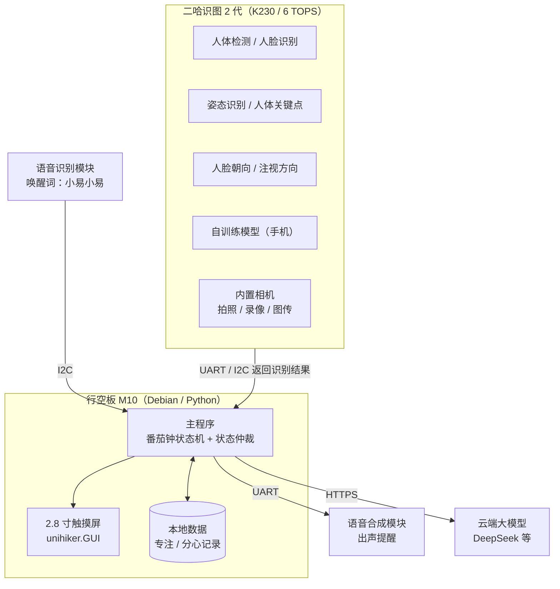

# 智能番茄时钟 Smart Tomato

> 一台会"盯着你学习"的番茄钟。基于 **行空板 M10 + 二哈识图 2 代**，用视觉传感器判断你在不在座位上、有没有在玩手机、坐姿是否端正、目光是否落在作业上，在你走神时出声提醒；想问题时喊一声"小易小易"，拍下题目交给大模型讲解。

[]()
[]()
[]()
[]()

---

## 目录

- [1. 项目简介](#1-项目简介)
- [2. 功能特性](#2-功能特性)
- [3. 硬件清单](#3-硬件清单)
- [4. 接线说明](#4-接线说明)
- [5. 系统架构](#5-系统架构)
- [6. 部署与运行](#6-部署与运行)
- [7. 配置说明](#7-配置说明)
- [8. 使用说明](#8-使用说明)
- [9. 常见问题](#9-常见问题)
- [10. 已知限制与路线图](#10-已知限制与路线图)
- [11. 问题反馈](#11-问题反馈)
- [12. 版权声明](#12-版权声明)
- [附录 A：为什么必须用二哈识图 2 代](#附录-a为什么必须用二哈识图-2-代)

---

## 1. 项目简介

写作业时最大的敌人不是难题，而是走神。**智能番茄时钟**把"番茄工作法"和"学习状态监督"合二为一：

- 它**看得见你**——判断你是否还在座位上；
- 它**管得住你**——检测到玩手机、趴桌、目光偏离时主动出声提醒；
- 它**懂你的习惯**——记录专注与分心数据，由大模型给出个性化学习建议，并自动调整番茄钟节奏；
- 它**讲得清题**——语音唤醒后拍照，题目交给大模型逐步讲解。

与普通番茄钟 App 的区别：本设备是**独立硬件**，不依赖手机，也不会被手机上的其他通知打断。

### 核心选型：为什么是二哈识图 2 代

本项目最关键的硬件决策是选用 **二哈识图 2 代（HUSKYLENS 2）** 作为唯一的视觉模块。原因是它把本项目需要的**全部**视觉能力都做成了开机即用的内置模型，且**推理在传感器内部完成**：

| 项目需求 | 二哈 2 代对应能力 |
|---|---|
| 人是否在座 | 人体检测 / 人脸识别 |
| 是否在玩手机 | 自训练模型（可自行标注样本训练） |
| 坐姿异常 | 人体关键点检测 / 姿态识别 |
| 朝向是否对着作业 | 人脸朝向检测 / 注视方向检测 |
| 拍照解题取图 | 内置照相机 / 实时图传 |

由此带来的直接收益：

1. **M10 不再承担视觉推理**——M10 算力有限（四核 1.2GHz / 512MB 内存），把推理放在二哈内部，M10 只负责逻辑、显示与联网；
2. **不需要额外的 USB 摄像头**——二哈 2 代自带 200 万像素摄像头，M10 唯一的 USB Type-A 口得以释放；
3. **开发量大幅下降**——从"训练模型 + 调参 + 降级策略"变成"选择内置模型 + 读取结果"。

> 相比之下，二哈识图 **1 代**不输出图像、不支持自训练、无姿态类模型，只能完成"人是否在座"一项。详见[附录 A](#附录-a为什么必须用二哈识图-2-代)。

---

## 2. 功能特性

### 2.1 时间显示与番茄钟

- 2.8 寸屏横屏显示大号数字时钟 + 日期星期
- 标准番茄钟状态机：专注 → 短休息 → 专注 → …… → 长休息
- 专注时长、休息时长可配置；支持手动暂停与跳过

> 状态：**横屏时钟已实现**（`m10_landscape_clock.py`），番茄钟状态机规划中。

### 2.2 学习状态监督

全部由二哈识图 2 代的内置模型完成：

| 状态 | 二哈 2 代模型 | 可靠性 |
|---|---|---|
| 人是否在座 | 人体检测 / 人脸识别 | 高 |
| 是否在玩手机 | 自训练模型（需自行采集样本训练） | 中高 |
| 坐姿异常（低头、趴桌） | 人体关键点检测 / 姿态识别 | 中高 |
| 朝向是否对着作业 | 人脸朝向检测 / 注视方向检测 | 中高 |

判定为"开小差"后，通过语音合成模块出声提醒。提醒策略采用**渐进式**：首次轻声提示，持续分心则提高提醒强度，避免频繁打断心流。

> 状态：规划中。

### 2.3 学习习惯学习

- **数据记录**：每次专注的起止时间、分心次数、分心发生的时段分布
- **LLM 分析**：把历史数据交给大模型，生成个性化的学习建议（如"你在 20:00 后专注度明显下降"）
- **自动调整**：根据历史规律自动调整番茄钟时长与提醒时机

> 状态：规划中。

### 2.4 语音唤醒拍照解题

1. 说出唤醒词"小易小易"，设备进入待命
2. 再说"开始识别"，二哈识图 2 代连拍多张
3. 设备自动**挑选最清晰的一张**（清晰度评分）
4. 上传至云端大模型，返回分步讲解并在屏幕上显示

> 状态：规划中。

---

## 3. 硬件清单

| 类别 | 型号 / 规格 | 数量 | 说明 |
|---|---|---|---|
| 主控 | **行空板 M10**（UNIHIKER，DFR0706） | 1 | RK3308 四核 1.2GHz / 512MB DDR3 / 16GB eMMC / Debian 10 |
| 视觉 | **二哈识图 2 代**（HUSKYLENS 2，SEN0638） | 1 | K230 双核 1.6GHz / 6 TOPS / 1GB LPDDR4 / 8GB eMMC，内置 20+ 模型与 200 万像素相机 |
| 语音 · 输入 | 离线语音识别模块（SEN0539 一类） | 1 | I2C/UART，唤醒词"小易小易" |
| 语音 · 输出 | DFRobot 语音合成模块（TTS） | 1 | UART，用于出声提醒与语音反馈 |
| 显示 | 行空板板载 2.8 寸 240×320 触摸彩屏 | — | 无需外接 |
| 电源 | Type-C 5V / 2A 电源适配器 | 1 | 仅可从 Type-C 口供电 |

> ⚠️ **待确认**：语音识别与语音合成模块的具体型号请以实物为准，上表为按"唤醒词『小易小易』"推断的对应型号。

### 二哈识图 2 代规格

| 项目 | 参数 |
|---|---|
| 处理器 / 算力 | Kendryte K230 双核 1.6GHz / 6 TOPS |
| 内存 / 存储 | 1GB LPDDR4 / 8GB eMMC |
| 屏幕 | 2.4 寸 640×480 IPS 全贴合电容触摸 |
| 摄像头 | GC2093 200 万像素，1/2.9"，60FPS，可替换模组 |
| 其他 | 电容麦克风、1W 音腔喇叭、补光灯 ×2、RGB 灯、按键 ×1 |
| 接口 | Type-C ×1、4Pin Gravity（UART/I2C）×1、TF 卡槽 ×1 |
| 尺寸 / 重量 | 70 × 58 × 19 mm / 90 g |
| 供电 / 功耗 | 3.3–5V / 1.5–3W |

### 行空板 M10 板载资源（无需外接）

| 功能 | 说明 |
|---|---|
| CPU / 内存 / 存储 | RK3308 四核 1.2GHz（Arm 64 位）/ 512MB DDR3 / 16GB eMMC |
| 操作系统 | Debian 10，预装完整 Python 环境 |
| 屏幕 | 2.8 寸 240×320 可触控彩屏 |
| 麦克风 | 板载电容硅麦克风 |
| 蜂鸣器 | 板载无源蜂鸣器 |
| 传感器 | 光线传感器、六轴传感器（加速度 + 陀螺仪） |
| 按键 | Home 键、A 键、B 键 |
| 无线 | Wi-Fi 2.4G + 蓝牙 4.0 |

---

## 4. 接线说明

| 外设 | 外设接口 | 接入 M10 的端口 |
|---|---|---|
| 二哈识图 2 代 | 4Pin Gravity（UART/I2C） | **4Pin I2C 通道 1**（或金手指 UART） |
| 语音识别模块 | 4Pin I2C | **4Pin I2C 通道 2** |
| 语音合成模块 | UART | **金手指 UART**（或 3Pin I/O） |

M10 提供 **2 路独立的 4Pin I2C** 与金手指上 1 路 UART，恰好满足三个模块各占一路，互不冲突。

### 接线注意事项

1. **供电**：仅可从 Type-C 口供电，输入电压不得超过 5.5V，否则可能烧毁主板芯片。
2. **二哈 2 代功耗**：其功耗为 1.5–3W，明显高于一般传感器。若同时接入语音模块后出现工作不稳定，请为二哈 2 代**独立供电**，不要仅依赖 4Pin 口的供电能力。
3. **USB Type-A 已释放**：由于二哈 2 代自带相机，本项目不再占用 USB 口，可用于调试或其他外设。
4. **接线细节以官方文档为准**：二哈 2 代的引脚定义与主控适配说明，请查阅 DFRobot 官方《二哈识图 2 适配主控板使用说明》。

---

## 5. 系统架构



### 数据流说明

1. **状态监督回路**（本地、离线）：二哈 2 代内部完成全部视觉推理，只把结构化结果（是否有人、姿态、朝向、是否检测到手机）通过 UART/I2C 回传给 M10；M10 据此决定是否触发提醒。
2. **番茄钟回路**（本地、离线）：主程序维护计时状态，驱动屏幕刷新与语音提示。
3. **解题回路**（联网）：语音唤醒 → 二哈 2 代连拍 → 择优 → HTTPS 上传大模型 → 结果回显。
4. **习惯学习回路**（联网）：本地数据 → 汇总上传 → 大模型分析 → 返回建议并调整番茄钟参数。

### 二哈 2 代内置能力清单

**内置模型（20+）：** 人脸检测、人脸识别、人脸五官检测、物体识别、物体追踪、物体分类、自学习分类、实例分割、颜色识别、手掌检测、手掌关键点检测、手势识别、人体检测、人体关键点检测、姿态识别、表情识别、注视方向检测、人脸朝向检测、车牌识别、文字识别、巡线追踪、标签识别、二维码识别、条形码识别、跌倒检测。

**内置应用：** 照相机、录像机、实时图传、MCP 服务、模型安装。

**其他能力：** 支持部署自行训练的模型、支持多模型串联/并联、支持模型广场下载官方与用户模型。

---

## 6. 部署与运行

### 6.1 开发环境

推荐使用 **Mind+ 的 Python 积木模式**（本机已验证可用）。

> 注意：Mind+ 的 **Python 代码模式在本版本不可用**（`canUse=false`），请使用积木模式。
> 工程目录：`%LOCALAPPDATA%\mind+\python-block\projects\<项目名>\`，运行入口为工程下的 `main.py`。

### 6.2 依赖

行空板 M10 的 Debian 环境预装了 Python 与常用库。本项目依赖：

```bash
pip install unihiker        # 屏幕与音频
pip install pillow          # 图像合成与旋转
pip install requests        # 云端大模型调用
pip install pinpong         # 驱动板载元件与扩展模块
```

二哈识图 2 代需要安装官方库：

```bash
pip install DFRobot_HuskylensV2
```

在 Mind+ 中使用时，请在**用户库**中搜索「二哈识图」并加载对应库文件。

### 6.3 运行

**方式一：Mind+ 积木模式**

1. 打开 Mind+ → 选择「Python 积木模式」
2. 打开本仓库对应项目，确认 `main.py` 为最新代码
3. 连接行空板 M10（USB 或 Wi-Fi）
4. 点击运行

**方式二：SSH 直接运行**

```bash
# 出厂默认连接信息
ssh root@10.1.2.3          # 密码：dfrobot

# 上传并运行
scp main.py root@10.1.2.3:/root/smarttomato/
ssh root@10.1.2.3 "cd /root/smarttomato && python3 main.py"
```

> 屏幕类程序需要持续运行，请勿让主进程退出。

### 6.4 二哈识图 2 代准备

1. 首次使用请将**固件更新至最新版本**（官方 FAQ 明确提示：功能缺失或通信异常时，首要动作就是更新镜像）；
2. 在设备触摸屏上把系统语言切换为中文；
3. 在屏幕上选择需要使用的内置模型（或部署自训练模型）；
4. 若需识别"手机"，需自行采集样本训练模型并导入。

---

## 7. 配置说明

主要参数集中在程序顶部的配置区：

| 参数 | 含义 | 默认值 |
|---|---|---|
| `FOCUS_MINUTES` | 单次专注时长（分钟） | 25 |
| `SHORT_BREAK_MINUTES` | 短休息时长（分钟） | 5 |
| `LONG_BREAK_MINUTES` | 长休息时长（分钟） | 15 |
| `WAKE_WORD` | 语音唤醒词 | 小易小易 |
| `DISTRACTION_TIMEOUT` | 持续分心多久触发提醒（秒） | 30 |
| `REMIND_LEVEL_STEP` | 提醒强度递进步长（秒） | 30 |
| `SHOT_COUNT` | 拍题连拍张数 | 5 |
| `LLM_API_BASE` | 大模型接口地址 | `https://api.deepseek.com` |
| `LLM_API_KEY` | 大模型 API Key | 从环境变量读取 |

### 密钥安全

**请勿将 API Key 硬编码进源码并提交到仓库。** 推荐做法：

```bash
export LLM_API_KEY="sk-xxxxxxxx"
```

或在项目根目录创建 `.env`（已加入 `.gitignore`）。

---

## 8. 使用说明

### 语音指令

| 指令 | 作用 |
|---|---|
| 小易小易 | 唤醒词，进入待命状态 |
| 开始学习 | 启动一个番茄钟 |
| 暂停 | 暂停计时 |
| 继续 | 恢复计时 |
| 开始识别 | 拍照并提交解题 |
| 我休息一下 | 提前进入休息 |

> 上述命令词为示例，可按语音识别模块的命令词表自行调整。

### 屏幕界面

- **待机**：横屏大号时钟 + 日期星期
- **专注中**：倒计时 + 剩余时间进度
- **提醒**：全屏提示 + 语音播报
- **解题**：题目原图 + 分步讲解

### 按键

| 按键 | 作用 |
|---|---|
| A 键 | 开始 / 暂停番茄钟 |
| B 键 | 切换显示模式 |
| Home 键 | 返回待机 |

---

## 9. 常见问题

**Q1：二哈 2 代能识别手机吗？**
能，但需要**自行训练**。内置的「物体识别」是预置类别，不一定包含手机；正确做法是用「自学习分类」或采集样本训练一个专用模型后导入。这是二哈 2 代相比 1 代最关键的能力差异。

**Q2：为什么不用二哈识图 1 代？**
1 代不输出图像、不支持自训练、无姿态与朝向类模型，只能完成"人是否在座"。详见[附录 A](#附录-a为什么必须用二哈识图-2-代)。

**Q3：断网还能用吗？**
可以。时钟、番茄钟、状态识别全部在本地运行；只有**解题**和**习惯分析**需要联网。

**Q4：M10 需要跑视觉模型吗？**
不需要。全部视觉推理在二哈 2 代内部完成，M10 只接收结构化结果。这也是本项目选用 2 代的核心原因。

**Q5：屏幕显示方向不对？**
修改 `m10_landscape_clock.py` 中的 `ROTATE` 参数：`90` 与 `270` 互为 180° 翻转，用于适配不同的横放方向。

**Q6：二哈 2 代屏幕卡住或花屏？**
- 卡住：开启模型后请等摄像头画面完全显示再操作；用代码切换算法时需在切换后加约 5 秒延时，频繁切换建议使用多模型模式。
- 花屏：多由静电引起，确保电源接地良好，避免接触金属外壳。

---

## 10. 已知限制与路线图

### 已知限制

1. **"玩手机"识别需要自训练**：二哈 2 代内置模型不含手机类别，需自行采集样本训练并导入，存在一定的准备成本与识别误差。
2. **解题依赖云端**：需要联网与 API Key，离线时该功能不可用。
3. **二哈 2 代体积与功耗**：70×58×19mm / 90g / 1.5–3W，做外壳时需预留空间，并注意供电。
4. **语音模块型号待确认**：README 中的语音模块型号为推断值，需以实物为准。
5. **隐私**：视觉推理在本地设备完成，不依赖云端；但拍题图片会上传至云端，请注意使用场景。

### 路线图

- [x] 横屏时钟显示
- [ ] 番茄钟状态机
- [ ] 二哈识图 2 代接入（人在 / 不在、姿态、朝向）
- [ ] 训练并导入"手机"自训练模型
- [ ] 语音识别模块接入（唤醒词）
- [ ] 语音合成模块接入（提醒播报）
- [ ] 云端大模型解题
- [ ] 学习数据记录与 LLM 习惯分析
- [ ] 自动调整番茄钟节奏
- [ ] 3D 打印外壳

---

## 11. 问题反馈

本项目为**闭源项目**，不接受外部代码贡献。

如在使用中发现文档错误、硬件兼容性问题或功能异常，欢迎通过 Issue 反馈。反馈时请注意：

1. 描述清楚硬件连接方式与复现步骤
2. **请勿附带任何 API Key、密码等敏感信息**
3. 附上相关日志或报错信息

---

## 12. 版权声明

版权所有 © 2026 smarttomato contributors。保留所有权利。

本项目**不开源**。未经版权所有者事先书面许可，任何个人或组织不得复制、修改、分发、再发布或将本项目用于商业用途。完整条款见 [LICENSE](./LICENSE)。

---

## 附录 A：为什么必须用二哈识图 2 代

本项目最初考虑过二哈识图 1 代，但它在三个层面存在硬性能力缺口，最终促使我们选用 2 代。

### A.1 二哈 1 代取不到图片

**架构层面**：1 代是**边缘 AI 视觉传感器**，不是摄像头。数据流为：

```
CMOS 传感器 → 内置 AI 芯片（K210）→ 只输出结构化结果
```

图像在芯片内部就被消费完毕，对外只暴露 `Block`（识别框 x, y, w, h, ID）与 `Arrow`（箭头方向），**没有原始图像输出**。

**协议层面**：官方 HUSKYLENS 协议中**不存在"取图"指令**。这是固件能力缺失，并非调用方式问题。

**带宽层面**：即使固件支持，物理层也不可行——

| 项目 | 数值 |
|---|---|
| 分辨率 | 320 × 240（QVGA） |
| 单帧像素数 | 76,800 |
| RGB565 单帧体积 | 76,800 × 2 B ≈ 150 KB ≈ 123 万比特 |
| UART 默认波特率 | 115,200 bps |
| **单帧传输耗时** | **≈ 11 秒** |

做"连拍几张挑最好"完全没有可操作性。

### A.2 二哈 1 代不支持自训练

1 代的「物体识别」是**预置固定类别**，无法教会它识别新目标；而"识别手机"正需要自训练能力。2 代明确支持**部署自行训练的模型**，并提供模型广场。

### A.3 二哈 1 代没有姿态与朝向模型

1 代仅有 6 种算法（人脸识别、物体追踪、物体识别、巡线、颜色识别、标签识别），**不含人体关键点、姿态识别、人脸朝向、注视方向检测**——而"坐姿异常"与"朝向是否对着作业"恰好依赖这些能力。

### A.4 结论

| 项目需求 | 二哈 1 代 | 二哈 2 代 |
|---|---|---|
| 人是否在座 | 支持（人脸识别） | 支持（人体检测 / 人脸识别） |
| 是否在玩手机 | 受限（不能自训练） | 支持（自训练模型） |
| 坐姿异常 | 不支持 | 支持（人体关键点 / 姿态识别） |
| 朝向是否对着作业 | 不支持 | 支持（人脸朝向 / 注视方向检测） |
| 拍照取图 | 不支持 | 支持（内置相机 / 图传） |
| 与大模型联动 | 不支持 | 支持（内置 MCP 服务） |

**因此本项目选用二哈识图 2 代作为唯一视觉模块。**

---

<p align="center">用一块板子，把"专注"这件事变得可测量。</p>
